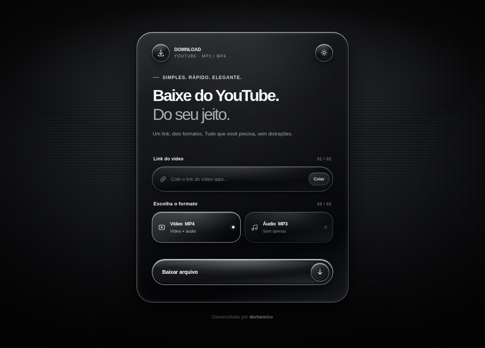
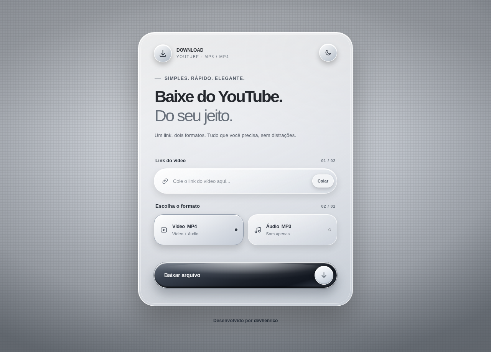

<div align="center">

# 🎬 Download YouTube

**🖤 Black Liquid Glass · 🎥 MP4 · 🎧 MP3**

Aplicação web com interface elegante e responsiva para baixar vídeos e extrair áudio de links do YouTube, priorizando a melhor qualidade disponível.

**Python · Flask · yt-dlp · FFmpeg · HTML · Sass (SCSS) · JavaScript**

[⚡ Início rápido](#inicio-rapido) · [💻 Execução local](#execucao-local) · [☁️ Render](#deploy-render) · [📖 API](#documentacao-api) · [🩺 Ajuda](#solucao-problemas)

</div>

## ✨ Prévia

| Tema escuro | Tema claro |
|:--:|:--:|
|  |  |

O favicon do projeto fica em `static/favicon.ico` e é usado tanto no site quanto na documentação Scalar.

A interface utiliza **Manrope**, botões com aparência de vidro, efeitos de luz, layout responsivo e alternância entre temas.

## 🚀 Funcionalidades

- Download de **vídeo MP4** com vídeo e áudio selecionados da melhor fonte disponível, sem limitar artificialmente a resolução.
- Extração de **áudio MP3 em 320 kbps** a partir do melhor áudio de origem disponibilizado; essa taxa de saída não melhora a qualidade da fonte.
- Incorporação de **metadados e miniatura/capa** quando o conteúdo e o contêiner permitem.
- Suporte a vídeos individuais (`youtube.com`, `youtu.be`, Shorts, transmissões e YouTube Music). Links com `&list=`, `&start_radio=` e outros parâmetros são automaticamente normalizados; **playlists e rádios completas nunca são baixadas**.
- Validação dos links, nomes de arquivos tratados e mensagens de erro legíveis.
- **Uma conversão por vez por processo**, evitando concorrência excessiva em servidores de poucos recursos.
- Arquivos temporários removidos após o encerramento do envio da resposta.
- Interface com temas **Black Liquid Glass** escuro e claro, seleção entre MP4/MP3, botão de colar e avisos de estado.
- Endpoint de saúde em `GET /health`.
- Documentação interativa com **Scalar API Reference** em `GET /docs` e especificação **OpenAPI 3.1** em `GET /openapi.json`.
- Script de terminal opcional para baixar diretamente na sua máquina.

> **Qualidade:** a seleção depende das faixas efetivamente disponibilizadas pelo YouTube. A montagem ou conversão para MP4 pode exigir recodificação, com maior uso de CPU e possível perda de qualidade. Conversão MP3 a 320 kbps não recupera detalhes ausentes no áudio original.

## 🗂️ Estrutura do projeto

```text
download-youtube/
├── docs/
│   ├── preview-dark.png    # Captura do tema escuro
│   └── preview-light.png   # Captura do tema claro
├── ffmpeg/                 # Conversão de áudio e vídeo
├── static/
│   ├── favicon.ico         # Ícone da aba
│   ├── scss/
│   │   ├── style.scss      # Fonte Sass: Liquid Glass, temas e estados com &
│   │   └── docs.scss       # Fonte Sass da documentação Scalar
│   ├── css/
│   │   ├── style.css       # CSS compilado, servido pelo Flask
│   │   └── docs.css        # CSS compilado da documentação
│   └── js/
│       ├── app.js          # Formulário, tema, clipboard, animações e salvamento
│       └── docs.js         # Inicialização do Scalar API Reference
├── templates/
│   ├── index.html          # Estrutura semântica da interface
│   └── docs.html           # Interface da documentação Scalar
├── .gitignore              # Define quais arquivos e pastas o Git deve ignorar
├── app.py                  # Rotas Flask, validação HTTP e envio de arquivos
├── download-youtube.py     # Modo opcional de linha de comando
├── downloader.py           # yt-dlp, FFmpeg, opções de qualidade e metadados
├── openapi.json            # Contrato OpenAPI das rotas HTTP
├── package-lock.json       # Fixa as versões das dependências npm para garantir instalações consistentes
├── package.json            # Scripts para compilar/observar Sass (apenas desenvolvimento)
├── README.md               # Documentação do projeto, instalação, uso e deploy
├── render.yaml             # Infraestrutura/implantação no Render
└── requirements.txt        # Dependências Python
```

Não é necessário criar arquivo `.env` nem banco de dados. Os arquivos **CSS já acompanham o repositório compilados**, portanto o Flask e o Render funcionam sem Node.js/Sass em produção. Compile novamente apenas quando editar os arquivos `.scss`.

<a id="inicio-rapido"></a>
## ⚡ Início rápido

Se você já tem **Python** e **Deno** instalados, execute na pasta do projeto:

```bash
python -m pip install -r requirements.txt
python app.py
```

Abra **http://localhost:10000** para acessar a aplicação ou **http://localhost:10000/docs** para consultar a documentação interativa. Para instalar as ferramentas e preparar o Render, siga o guia completo abaixo.

## 🧰 Requisitos

- **Python 3.10 ou superior** (recomendado: versão recente compatível com as dependências).
- **Deno 2.3+** acessível no `PATH` — fornece suporte a desafios JavaScript do YouTube para versões recentes do `yt-dlp`. No Render, o `render.yaml` instala automaticamente.
- Conexão com a internet e espaço temporário compatível com o tamanho do vídeo.
- Navegador moderno com suporte a `backdrop-filter` para os melhores efeitos visuais.
- **Node.js e npm somente para desenvolver os estilos Sass**; não são necessários para executar o Flask nem para publicar no Render.

As dependências Python são instaladas por `requirements.txt`. O pacote `imageio-ffmpeg` fornece o executável FFmpeg utilizado pelo projeto; `mutagen` ajuda na incorporação de metadados/capas.

<a id="execucao-local"></a>
## 💻 Execução local

### 1. Obtenha o código

Baixe e extraia o ZIP do projeto ou clone o repositório GitHub após publicar os arquivos.

### 2. Configure o Python

**Windows / PowerShell:**

```powershell
cd download-youtube
py -m venv .venv
.venv\Scripts\Activate.ps1
python -m pip install --upgrade pip
pip install -r requirements.txt
```

**Linux / macOS:**

```bash
cd download-youtube
python3 -m venv .venv
source .venv/bin/activate
python -m pip install --upgrade pip
pip install -r requirements.txt
```

### 3. Instale o Deno

Instale o Deno pelas instruções oficiais em [docs.deno.com](https://docs.deno.com/runtime/getting_started/installation/) e confirme:

```bash
deno --version
```

A instalação pelo `pip install -r requirements.txt` inclui o componente EJS necessário ao `yt-dlp` (`yt-dlp[default]`). O aplicativo habilita o Deno e os componentes EJS do npm ao acessar o YouTube. Não é preciso configurar cookies ou chave de API para vídeos públicos comuns.

### 4. Inicie o servidor

```bash
python app.py
```

Acesse **http://localhost:10000** no navegador. A porta padrão é `10000`, a menos que o ambiente defina `PORT`.

### Modo terminal (opcional)

Sem iniciar o site, execute:

```bash
python download-youtube.py
```

Informe a URL e escolha `mp4` ou `mp3`. O arquivo será salvo no diretório em que o comando for executado; o programa evita sobrescrever arquivos com o mesmo nome.

<a id="deploy-render"></a>
## ☁️ Deploy no Render

O repositório contém o **`render.yaml`**, que configura um Web Service Python com Gunicorn.

1. Publique a **estrutura inteira** do projeto no GitHub, preservando as pastas `templates/` e `static/`.
2. No [Render Dashboard](https://dashboard.render.com/), crie um novo **Blueprint** conectado ao repositório ou configure o serviço com os comandos abaixo.
3. Confirme o deploy. O build instala as dependências Python e o Deno em `.deno/` dentro do diretório de build.
4. Abra a URL gerada pelo Render e confira `https://SEU-SERVICO.onrender.com/health` — o retorno esperado é `{"status":"ok"}`.

**Build Command (equivalente ao YAML):**

```bash
pip install -r requirements.txt && (test -x .deno/bin/deno || (curl -fsSL https://deno.land/install.sh | DENO_INSTALL="$PWD/.deno" sh))
```

**Start Command:**

```bash
PATH="$PWD/.deno/bin:$PATH" gunicorn --bind 0.0.0.0:${PORT:-10000} --workers 1 --threads 2 --timeout 600 app:app
```

**Por que 1 worker?** O servidor utiliza uma trava em memória para permitir um download simultâneo por processo. Vários workers exigiriam uma fila/trava compartilhada para aplicar o mesmo limite a toda a aplicação.

> **Limites do plano gratuito:** vídeos grandes podem estourar memória, espaço temporário ou timeout; algumas requisições feitas a partir de datacenters podem ser bloqueadas pelo YouTube. O endpoint `/health` confirma que o Flask responde, mas não garante que um vídeo específico esteja disponível.

## 🧠 Como funciona

```text
Navegador → POST /download
                  │
           Flask valida URL e formato
                  │
             downloader.py
                  │
          yt-dlp seleciona faixas
                  │
        FFmpeg mescla ou converte
                  │
       Capa e metadados (se possível)
                  │
     Flask transmite o arquivo resultante
                  │
    Limpeza dos temporários após o envio
```

O frontend **remove automaticamente os parâmetros extras** ao colar um link, e o backend faz a mesma validação de forma independente, antes de acessar o YouTube. O `yt-dlp` também mantém `noplaylist=True` como proteção adicional.

Por exemplo, se alguém colar este endereço de rádio:

```text
https://www.youtube.com/watch?v=5r9e2ptR9iE&list=RD5r9e2ptR9iE&start_radio=1
```

O programa processará somente:

```text
https://www.youtube.com/watch?v=5r9e2ptR9iE
```

URLs que contenham apenas uma playlist (`youtube.com/playlist?list=...`) são recusadas porque não identificam um vídeo individual.

O frontend envia o formulário com `fetch` e cria o download do arquivo no navegador. **A implementação atual usa `response.blob()`**, portanto carrega o arquivo na memória do navegador antes de salvá-lo. Para uso frequente com arquivos muito grandes, uma evolução recomendada é implementar streaming para o disco, com tratamento adequado do progresso e dos erros.

### Endpoints

| Método | Rota | Função | Resposta |
|---|---|---|---|
| `GET` | `/` | Interface do aplicativo | HTML |
| `GET` | `/health` | Verifica disponibilidade da aplicação | JSON `{"status":"ok"}` |
| `POST` | `/download` | Recebe `url` e `format` (`mp3` ou `mp4`) | Arquivo ou erro HTTP |
| `GET` | `/docs` | Documentação interativa Scalar API Reference | HTML |
| `GET` | `/openapi.json` | Especificação OpenAPI 3.1 | JSON |

**Erros principais:** `400` para link de vídeo/formato inválido (inclusive links exclusivos de playlist), `429` quando já existe um download nesse processo, `502` para falhas conhecidas de extração/conversão e `500` para outras falhas no servidor.

<a id="documentacao-api"></a>
### 📖 Documentação interativa (Scalar + OpenAPI)

Este projeto utiliza **[Scalar API Reference](https://scalar.com/products/api-references)** como interface interativa e **OpenAPI 3.1** como especificação. **Não usa Swagger UI.**

Após iniciar a aplicação localmente, abra:

- **Interface Scalar:** [`http://localhost:10000/docs`](http://localhost:10000/docs)
- **Documento OpenAPI:** [`http://localhost:10000/openapi.json`](http://localhost:10000/openapi.json)
- **Saúde:** [`http://localhost:10000/health`](http://localhost:10000/health)

No Render, substitua `http://localhost:10000` pelo endereço público do seu serviço. O Scalar usa o mesmo domínio (`/openapi.json`), sem chave de API ou configuração `.env`. Para exibir a interface do Scalar, o navegador precisa conseguir carregar seu módulo JavaScript do **jsDelivr** (CDN). A página principal funciona independentemente disso.

**Exemplo de chamada com `curl`:**

```bash
curl -X POST "http://localhost:10000/download" \
  --data-urlencode "url=https://www.youtube.com/watch?v=jfKfPfyJRdk" \
  --data-urlencode "format=mp3" \
  --output audio.mp3
```

O formulário aceita `multipart/form-data` e `application/x-www-form-urlencoded`. A resposta de sucesso de `/download` é **binária** (um arquivo MP3 ou MP4), com `Content-Disposition`; erros são retornados como texto, não como JSON. Também pode retornar `413` se o formulário exceder o limite de 8 KiB.

> **Atenção ao botão de teste da documentação:** chamar `/download` pela interface Scalar pode iniciar uma operação demorada e transferir mídia ao navegador. O projeto não possui autenticação, rate limiting por IP nem fila de downloads. Adicione essas proteções antes de expor a API para uso intenso.

Para modificar descrições, exemplos, códigos de resposta ou esquemas da documentação, edite `openapi.json`. Se adicionar uma rota em `app.py`, atualize esse arquivo também. O `static/js/docs.js` apenas configura a interface Scalar.

## 🎨 Personalização — Sass (SCSS)

O visual do projeto é mantido em **Sass com sintaxe SCSS**, incluindo seletores aninhados usando `&`. Por exemplo:

```scss
.input-shell {
  border: 1px solid var(--stroke);

  &:focus-within {
    border-color: rgba(250, 252, 255, .73);
  }
}

.site-credit {
  & a {
    transition: color .2s ease;

    &:hover {
      color: #f2f3f5;
    }
  }
}
```

### ⚙️ Compilar os estilos

Instale Node.js com npm **somente na máquina usada para desenvolver o CSS**. Na raiz do projeto, execute:

```bash
npm install
npm run sass:build
```

Para recompilar automaticamente sempre que salvar uma alteração:

```bash
npm run sass:watch
```

Os scripts convertem os arquivos `static/scss/*.scss` em `static/css/*.css` usando o **Dart Sass**, sem gerar arquivos `.map`. **Edite os `.scss`, não os `.css`**: o CSS será sobrescrito na próxima compilação.

| Alteração desejada | Arquivo |
|---|---|
| Cores, sombras, bordas, hover, fontes e temas | `static/scss/style.scss` |
| Moldura e estilos da referência Scalar | `static/scss/docs.scss` |
| CSS gerado e servido pelo Flask | `static/css/style.css`, `static/css/docs.css` |
| Textos, títulos, cards e estrutura | `templates/index.html` |
| Tema claro/escuro, eventos e mensagens | `static/js/app.js` |
| Rotas Flask, envio, limpeza e respostas | `app.py` |
| Seleção de qualidade, formato, capa e metadados | `downloader.py` |
| Implantação e recursos do servidor | `render.yaml` |
| Documentação das rotas e exemplos de requisição | `openapi.json` |
| Estrutura e inicialização do Scalar | `templates/docs.html`, `static/js/docs.js` |

O frontend utiliza os arquivos CSS estáticos servidos pelo Flask; **não é necessário instalar npm no Render**. Depois de editar o SCSS, execute o build e publique **o SCSS e o CSS compilado juntos**. Caso veja estilos antigos, recarregue a página ignorando o cache (`Ctrl + F5`).

## 🛡️ Considerações de segurança e uso

- São aceitos apenas URLs HTTPS/HTTP de domínios do YouTube definidos em `downloader.py`; a validação é refeita no servidor, mesmo que o navegador também valide.
- O backend não recebe nomes de arquivos do usuário e higieniza o nome de download gerado.
- Arquivos temporários não são persistidos como biblioteca de mídia; sua exclusão ocorre quando a resposta é encerrada.
- A trava de simultaneidade existe **por processo**, não é uma fila distribuída; o servidor não implementa contas, autenticação ou controle de consumo por usuário.
- Use somente conteúdo que você tem permissão para baixar, respeitando os direitos autorais e os termos aplicáveis. O projeto não foi concebido para contornar DRM, restrições de assinatura ou controles de acesso.
- Para exposição pública com grande tráfego, é recomendável adicionar limite de requisições por IP, controle de tamanho/tempo, filas de tarefas, monitoramento e limites de uso.

<a id="solucao-problemas"></a>
## 🩺 Solução de problemas

<details>
<summary><strong>Erro ao extrair vídeo / formatos indisponíveis</strong></summary>

Confirme que o vídeo é público e pode ser reproduzido no YouTube. Atualize `yt-dlp[default]`, confira o Deno (`deno --version`) e consulte os logs do Render. Alterações frequentes do YouTube podem interromper a extração temporariamente. Consulte a [documentação EJS do yt-dlp](https://github.com/yt-dlp/yt-dlp/wiki/EJS).

</details>

<details>
<summary><strong>MP4 demora muito ou encerra com erro</strong></summary>

O melhor vídeo pode exigir recodificação para MP4 e consumir muito processamento/armazenamento. Tente outro vídeo menor ou um plano com mais recursos. A capacidade não é ilimitada no Render gratuito.

</details>

<details>
<summary><strong>MP3 sem capa ou vídeo sem miniatura incorporada</strong></summary>

A miniatura deve estar disponível e o pós-processamento precisa ser suportado pelo formato. Verifique os logs de `yt-dlp` e do FFmpeg. Nem todo aplicativo exibe a capa de um MP4 da mesma maneira.

</details>

<details>
<summary><strong>Botão informa que há outro download em andamento</strong></summary>

O serviço foi configurado para permitir uma conversão por vez por processo. Aguarde a conclusão da tarefa atual. Em caso de interrupção grave, a reinicialização do worker pode limpar uma conversão travada; avalie os logs antes.

</details>

<details>
<summary><strong>Interface aparece sem Liquid Glass</strong></summary>

Confirme que você compilou as alterações SCSS (`npm run sass:build`) e publicou `static/css/style.css` e `static/js/app.js`, e que o HTML é renderizado pela rota Flask (não aberto diretamente como arquivo local). No navegador, use `Ctrl + F5` para ignorar o cache.

</details>

<details>
<summary><strong>O download começou, mas o arquivo não aparece no navegador</strong></summary>

Verifique o bloqueio de downloads do navegador e o espaço disponível. O frontend atual recebe o arquivo inteiro em memória antes de gravá-lo, o que pode falhar com mídias grandes. No modo CLI (`python download-youtube.py`), o salvamento ocorre diretamente no disco da máquina.

</details>

## 🔗 Documentação de referência

- [Flask](https://flask.palletsprojects.com/)
- [yt-dlp](https://github.com/yt-dlp/yt-dlp)
- [Suporte EJS e Deno no yt-dlp](https://github.com/yt-dlp/yt-dlp/wiki/EJS)
- [FFmpeg](https://ffmpeg.org/)
- [Sass — seletor pai `&`](https://sass-lang.com/documentation/style-rules/parent-selector/)
- [Render — Blueprint YAML](https://render.com/docs/blueprint-spec)

## 👨‍💻 Autor

**Desenvolvido por [devhenrico](https://github.com/devhenrico)**
